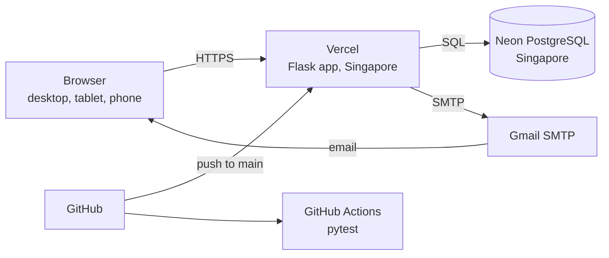
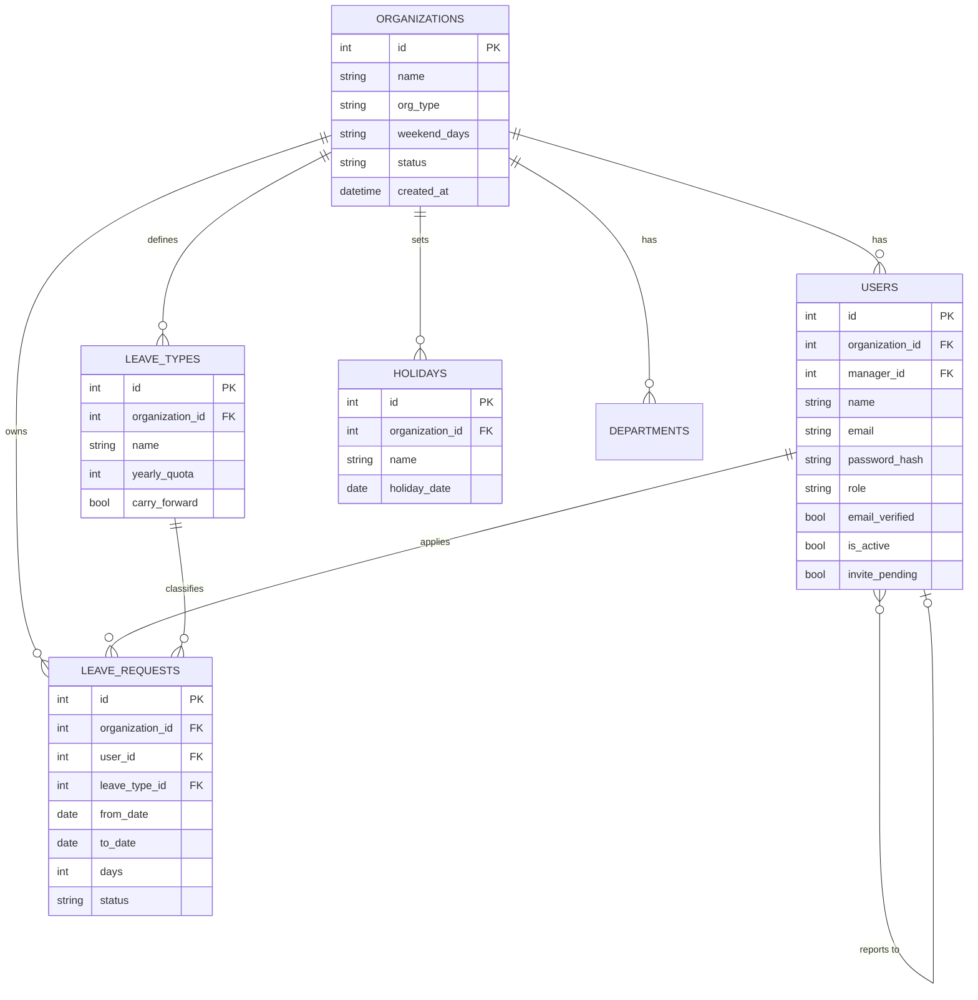
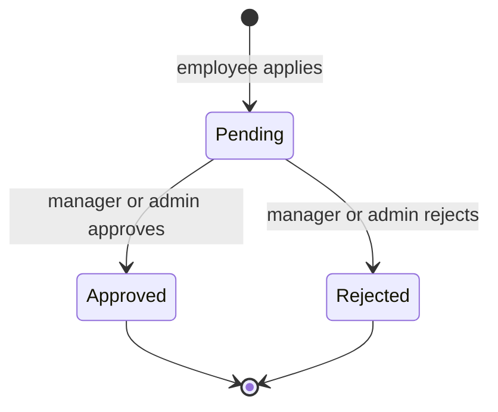

# LeaveOk


**A multi-organization leave management system.** Schools, colleges, banks and offices each get a private workspace with their own people, leave types, holidays and approvals. One application, many institutions, and no organization can ever see another's data.

**Live app:** https://YOUR-APP.vercel.app
**Demo video:** https://YOUR-VIDEO-LINK


---

## Table of contents

1. [Overview](#overview)
2. [Features](#features)
3. [Tech stack](#tech-stack)
4. [Architecture](#architecture)
5. [Data model](#data-model)
6. [Project structure](#project-structure)
7. [Roles and permissions](#roles-and-permissions)
8. [Page map](#page-map)
9. [How the main flows work](#how-the-main-flows-work)
10. [Emails the app sends](#emails-the-app-sends)
11. [Security](#security)
12. [Design and responsiveness](#design-and-responsiveness)
13. [Configuration](#configuration)
14. [Run it locally](#run-it-locally)
15. [Command line tools](#command-line-tools)
16. [Testing and CI](#testing-and-ci)
17. [Deployment](#deployment)
18. [Screenshots](#screenshots)
19. [Known limits](#known-limits)
20. [Roadmap](#roadmap)

---

## Overview

Every institution manages leave differently. A school has duty leave and Sunday-only weeks, a bank has privilege leave with carry-forward, an office has annual and sick leave with a two-day weekend. LeaveOk handles all of them with **configuration instead of custom code**: each organization chooses a starting template (School, College, Corporate, Bank, or Other) and then edits its own leave types, quotas, weekly offs and holidays.

**The idea in one picture:** a building (the app) with many private flats (organizations). Each flat has its own rules, residents and mail, and the walls between flats are tested automatically.

---

## Features

### For organizations
- **Self-serve sign-up** with real-email checking (the email domain must be able to receive mail) and email verification before the first login
- **Starter templates** for School, College, Corporate, Bank and Other, with sensible leave types and weekly offs
- **Invitation-based onboarding:** the admin enters an email, a role and a manager. The person receives a one-time link, enters their own details and chooses their own password. The admin never sees or sets passwords
- **People management:** change roles and managers, deactivate and reactivate people, resend invitations, protection against reporting loops, and automatic hand-over of a team when its manager is demoted or deactivated

### For leave
- **Configurable leave types and quotas** per organization
- **Weekly offs and holidays** per organization. Leave is counted in **working days**, so weekends and holidays are never deducted
- **Checks on every request:** valid dates, no overlap with existing leave, enough balance, and not longer than a year
- **Approvals:** the employee's manager approves, or the organization admin when there is no manager. Nobody can approve their own request, and a decision is final
- **Team calendar:** a monthly view of who is away, with holidays and weekly offs highlighted
- **Reports and CSV export:** filter by year, status, leave type and person. Managers see only their team. Exports open cleanly in Excel

### For the platform owner
- **A separate owner login** (no sign-up, no organization) whose email and password hash live in environment settings
- **Platform overview:** totals, and a list of every organization with its admin, number of people, number of leave requests and last activity
- **Suspend and reactivate** an organization to stop abuse
- The owner sees organization-level facts only, never individual employees or their leave

### Account safety
- Forgot-password flow with one-time, expiring links
- Login lockout after repeated wrong passwords
- Throttled verification, invitation and reset emails

---

## Tech stack

| Layer | Technology | Used for |
|---|---|---|
| Language | **Python 3.11+** | Whole backend |
| Web framework | **Flask** | Routes, templates, sessions |
| Database | **PostgreSQL** (hosted on **Neon**) | All data |
| ORM and migrations | **Flask-SQLAlchemy**, **Flask-Migrate** (Alembic) | Models and versioned schema changes |
| Authentication | **Flask-Login**, **bcrypt** | Sessions and password hashing |
| Form security | **Flask-WTF** | CSRF protection on every form |
| Signed links | **itsdangerous** | Verification, invitation and reset tokens |
| Email checking | **email-validator** | Email syntax and domain check |
| Email sending | **smtplib** over **Gmail SMTP** | Notifications |
| Performance | **Flask-Compress** | Compressed responses |
| Configuration | **python-dotenv** | Reads `.env` locally |
| Templates | **Jinja2** | Server-rendered HTML |
| Frontend | **HTML5, CSS3, a little vanilla JavaScript** | No frontend framework |
| Fonts and icons | **Inter** (Google Fonts), inline **SVG** icons | Look and feel |
| Database driver | **psycopg2-binary** | PostgreSQL connection |
| Testing | **pytest** | Automated tests |
| Hosting | **Vercel** (serverless, Singapore region) | Runs the Flask app |
| CI | **GitHub Actions** | Runs the tests on every push |
| Version control | **Git** and **GitHub** | Source and history |

**Dev tools:** VS Code, Git, the Neon console (database), the Vercel dashboard (deployments and settings).

---

## Architecture



**Layers inside the app:**

| Layer | Folder | Job |
|---|---|---|
| Models | `app/models/` | What is stored |
| Routes | `app/routes/` | What happens when a user clicks (one file per area) |
| Services | `app/services/` | The business rules: balances, approvals, emails, reports, validation |
| Templates | `app/templates/` | The pages users see |

**Multi-tenancy:** every row that belongs to an organization carries an `organization_id`, and every query filters by it. Opening another organization's record returns "not found". This is verified by automated tests.

---

## Data model



**Life of a leave request:**



Pending and approved requests count against the balance. A rejected request gives the days back.

---

## Project structure

```
Smart-Leave-Management-System/
├── run.py                       # starts the app locally
├── index.py                     # entry point used by Vercel
├── vercel.json                  # Vercel settings (Singapore region)
├── config.py                    # settings read from environment variables
├── requirements.txt             # Python packages
├── pytest.ini                   # test settings
├── .env.example                 # the settings the app needs, with fake values
├── README.md
├── .github/workflows/tests.yml  # runs the tests on every push
│
├── app/
│   ├── __init__.py              # creates the Flask app, registers everything
│   ├── extensions.py            # database, login, CSRF, migrations
│   ├── cli.py                   # flask commands: seed-demo, delete-demo, owner-hash
│   │
│   ├── models/                  # database tables
│   │   ├── organization.py      # Organization, Department, Holiday
│   │   ├── user.py              # User
│   │   └── leave.py             # LeaveType, LeaveRequest
│   │
│   ├── routes/                  # pages, one file per area
│   │   ├── auth.py              # sign-up, login, verify, invite, forgot and reset password
│   │   ├── main.py              # landing page, dashboard, robots.txt, sitemap.xml
│   │   ├── leave.py             # apply, my leaves, approvals, calendar
│   │   ├── admin.py             # employees, leave types, holidays
│   │   ├── reports.py           # reports and CSV export
│   │   └── owner.py             # owner login and platform overview
│   │
│   ├── services/                # business rules
│   │   ├── leave_service.py     # working days, balances, overlaps, who can approve
│   │   ├── calendar_service.py  # monthly team calendar
│   │   ├── report_service.py    # report rows, summary, safe CSV
│   │   ├── email_service.py     # sending mail and signed links
│   │   ├── owner_stats.py       # platform totals and organization rows
│   │   ├── org_templates.py     # School, College, Corporate, Bank starters
│   │   └── validation.py        # email and password rules
│   │
│   ├── templates/               # Jinja pages
│   │   ├── base.html            # layout, menu, dark mode, footer
│   │   ├── landing.html         # public home page
│   │   ├── dashboard.html
│   │   ├── auth_base.html       # split layout for login and sign-up pages
│   │   ├── auth/                # login, register, accept, forgot, reset
│   │   ├── leave/               # apply, my, approvals, calendar
│   │   ├── admin/               # employees, leave_types, holidays
│   │   ├── reports/             # index
│   │   └── owner/               # login, organizations
│   │
│   └── static/                  # style.css, logo.svg, favicon.svg
│
├── migrations/                  # versioned database changes (Alembic)
│   └── versions/                # one file per schema change. Never delete these
│
└── tests/                       # automated test suite
    ├── conftest.py              # shared fixtures and test data builders
    ├── test_validation.py       # password and email rules
    ├── test_leave_service.py    # working days, balances, approval rules
    ├── test_auth.py             # sign-up, verification, login, lockout
    ├── test_invites.py          # invitation-based onboarding
    ├── test_accounts.py         # forgot password, people management
    ├── test_leave_flow.py       # apply, approve, calendar
    ├── test_admin.py            # leave types, holidays, weekly offs
    ├── test_reports.py          # reports and CSV
    ├── test_owner.py            # owner login and platform overview
    ├── test_owner_and_journey.py# one full end-to-end journey
    ├── test_security.py         # access control, data isolation, CSRF
    ├── test_public.py           # landing, robots, sitemap
    ├── test_ui.py               # responsive shell on every page
    └── test_demo.py             # demo data command
```

---

## Roles and permissions

| Action | Employee | Manager | Org admin | Owner |
|---|:---:|:---:|:---:|:---:|
| Apply for leave, see own leaves and balance | Yes | Yes | Yes | |
| See the team calendar | Own team | Own team | Everyone | |
| Approve or reject leave | | Own team | Everyone | |
| Reports and CSV export | | Own team | Everyone | |
| Invite people, change roles and managers, deactivate | | | Yes | |
| Edit leave types, quotas, holidays and weekly offs | | | Yes | |
| See all organizations, suspend or reactivate one | | | | Yes |

Nobody can approve their own request. An organization admin cannot be edited or deactivated from the Employees page.

---

## Page map

| Area | Pages |
|---|---|
| Public | `/` landing, `/login`, `/register`, `/forgot-password`, `/reset-password/<token>`, `/verify/<token>`, `/invite/<token>`, `/robots.txt`, `/sitemap.xml`, `/health` |
| Everyone signed in | `/dashboard`, `/leave/apply`, `/leave/my`, `/leave/calendar` |
| Managers and admins | `/leave/approvals`, `/reports/`, `/reports/export.csv` |
| Org admins | `/admin/employees`, `/admin/leave-types`, `/admin/holidays` |
| Owner | `/owner/login`, `/owner/organizations` |

---

## How the main flows work

**Creating an organization**
1. Someone signs up with an organization name, a type, their name, a real email and a strong password.
2. They click the verification link sent to their inbox, then log in. There is no approval step.
3. Default leave types and weekly offs for the chosen type are created automatically.

**Adding people (invitation flow)**
1. The admin enters an email, a role and a manager. No password is typed.
2. The person gets an email with a one-time link, valid for 7 days.
3. They enter their name and choose their own password. Their account is then active.
4. Until then the admin sees them as *invited*, and can resend the invitation.

**Applying and approving**
1. The employee picks a leave type and dates. The app counts working days, checks overlaps and balance, and saves a *pending* request.
2. The manager (or the admin, if there is no manager) is told a request is waiting.
3. They approve or reject. The employee is told the outcome, and the balance updates.

**Starter templates**

| Type | Leave types (days per year) | Weekly off |
|---|---|---|
| School | Casual 12, Medical 10, Duty 10 | Sunday |
| College | Casual 12, Medical 10, Duty 15, Earned 15 | Sunday |
| Corporate | Annual 24, Sick 12, Casual 8 | Saturday and Sunday |
| Bank | Privilege 30, Sick 12, Casual 12 | Sunday |
| Other | Casual 12, Sick 10 | Saturday and Sunday |

Admins can change all of this afterwards.

---

## Emails the app sends

| When | Who gets it | What it says |
|---|---|---|
| New organization signs up | The new admin | Verification link (valid 2 days) |
| Admin invites someone | The invited person | Invitation link (valid 7 days, works once) |
| Forgot password | The person who asked | Reset link (valid 1 hour, works once) |
| Leave request submitted | The employee's manager, or the admin if there is no manager | "A leave request is waiting for your approval" |
| Request approved or rejected | The employee who applied | "Your leave request was approved/rejected" |

**Privacy by design:** notification emails never contain names, dates or leave reasons. They only say that something needs attention, and people log in to see the details. All email passes through one shared sender account, so this keeps customer data out of any mailbox.

---

## Security

- **Passwords:** hashed with bcrypt. Organization users need 8 to 16 characters with upper case, lower case, a number and a symbol. The owner password is stricter: 12 to 72 characters
- **Verified emails:** a real-domain check at sign-up, plus a verification link before the first login
- **One-time links:** verification, invitation and reset links are signed, expire, and (for invitations and resets) stop working once used
- **Lockout and throttling:** 5 wrong passwords lock an account for 15 minutes. Verification, invitation and reset emails are limited to one per 10 minutes. Wrong owner logins wait one second
- **CSRF protection** on every form, and **role checks** on every protected page
- **Tenant isolation:** every query is scoped to the organization. Other organizations' records return "not found"
- **No secrets in code:** all keys and passwords come from environment variables. `.env` is never committed
- **Safe CSV export:** cells starting with `=`, `+`, `-` or `@` are neutralized so a spreadsheet cannot run them as formulas
- **Owner access:** a separate login, an 8-hour session, and a view limited to organization-level information
- **Account control:** deactivating a person ends their open sessions, and suspending an organization blocks everyone in it

---

## Design and responsiveness

- **Ocean trust theme:** deep navy `#0F2A4A`, bright blue `#1E6FD9`, teal accent `#12B5A6`
- **Responsive on phones, tablets and laptops:** the menu collapses into a button on small screens, and wide tables turn into stacked cards
- **Dark mode:** a toggle in the menu, remembered per device, and it follows the device setting by default
- **Landing page** with a hero, feature section, "how it works" steps and a sample dashboard card
- **SEO basics:** page titles, meta descriptions, Open Graph tags, `robots.txt` and `sitemap.xml`
- **Accessibility basics:** a skip link, form labels, readable contrast, and respect for reduced-motion settings
- **Performance:** compressed responses, and a small hand-written stylesheet with no frontend framework

---

## Configuration

| Variable | Required | Purpose |
|---|:---:|---|
| `SECRET_KEY` | Yes | Signs sessions and email links. Use a long random value |
| `DATABASE_URL` | Yes | PostgreSQL connection string (use the `postgresql+psycopg2://` form) |
| `OWNER_EMAIL` | For the owner | The owner's login email |
| `OWNER_PASSWORD_HASH` | For the owner | Bcrypt hash of the owner password (create it with `flask owner-hash`) |
| `MAIL_USERNAME` | For email | Sender Gmail address |
| `MAIL_PASSWORD` | For email | Gmail **App Password** (16 letters) |
| `FLASK_APP` | Local only | Set to `run.py` so `flask` commands work |

Copy `.env.example` to `.env` and fill in real values. **Never commit `.env`.**

---

## Run it locally

**1. Clone and set up Python**

```bash
git clone https://github.com/Pavan-agrawal985/Smart-Leave-Management-System.git
cd Smart-Leave-Management-System
python -m venv venv
venv\Scripts\activate            # Windows
# source venv/bin/activate       # macOS or Linux
python -m pip install -r requirements.txt
```

**2. Create a free PostgreSQL database** at [neon.com](https://neon.com) and copy its connection string.

**3. Create the settings file**

```bash
copy .env.example .env           # Windows
# cp .env.example .env           # macOS or Linux
```

Edit `.env` and fill in `SECRET_KEY`, `DATABASE_URL`, and the email settings.

**4. Create the owner password hash**

```bash
flask owner-hash
```

Type a strong password twice, then paste the printed `$2b$...` line into `.env` inside single quotes:

```
OWNER_EMAIL=you@example.com
OWNER_PASSWORD_HASH='$2b$12$...'
```

**5. Create the tables and start the app**

```bash
flask db upgrade
python run.py
```

Open http://127.0.0.1:5000. The owner logs in at `/owner/login`. Organizations sign up at `/register`.

**Gmail App Password:** turn on 2-Step Verification on the sender Gmail account, then create an App Password under Google Account, Security, App passwords. Use a dedicated account for the app.

---

## Command line tools

| Command | What it does |
|---|---|
| `flask db upgrade` | Applies database changes |
| `flask db migrate -m "message"` | Creates a new migration after a model change |
| `flask owner-hash` | Creates the value for `OWNER_PASSWORD_HASH` |
| `flask seed-demo --email you@gmail.com` | Creates "Demo University" with people, holidays and leave requests, using `you+demo-...@gmail.com` addresses |
| `flask delete-demo` | Removes the demo organization completely |

---

## Testing and CI

The project has **200+ automated tests**. They run on a throwaway in-memory database, never touch real data, never send real emails, and never need the internet.

```bash
python -m pytest -q
```

| Area | What is verified |
|---|---|
| Validation | Password boundaries and email rules |
| Leave rules | Working days with weekends and holidays, balances, overlaps, approval rights |
| Accounts | Sign-up, verification, login lockout, forgot password, invitations |
| People management | Roles, managers, reporting loops, deactivation and team hand-over |
| Reports | Filters, team scoping, safe CSV |
| Owner | Separate login, expiry, platform overview, suspend and reactivate |
| Security | Login required everywhere, role checks, **isolation between organizations**, CSRF |
| UI | Every page has the responsive shell, and static files are served |
| End to end | A full journey from sign-up to an approved leave |

**GitHub Actions** runs the whole suite on every push and pull request. A green tick means the code is safe to deploy.

---

## Deployment

The app runs on **free tiers**: Vercel for hosting and Neon for the database.

1. **Database:** create a Neon project in the Singapore region and copy its **pooled** connection string, written in the `postgresql+psycopg2://` form.
2. **Tables:** from your laptop (with `DATABASE_URL` pointing to Neon), run `flask db upgrade`.
3. **Vercel:** import the GitHub repository. `index.py` is the entry point, and `vercel.json` places the function in the Singapore region, next to the database.
4. **Environment variables** (Vercel, Settings, Environment Variables): `SECRET_KEY`, `DATABASE_URL`, `OWNER_EMAIL`, `OWNER_PASSWORD_HASH`, `MAIL_USERNAME`, `MAIL_PASSWORD`. Mark passwords and hashes as **Sensitive**, then **Redeploy**.
5. **Releasing:** every push to `main` redeploys automatically.

**Checks after deploying:** `/health` says "Database connected", `/owner/login` opens, and a test sign-up delivers its verification email.

**Note:** Vercel's free (Hobby) plan is for non-commercial use. Before charging customers, move to a paid plan or another host. Nothing in the code needs to change.

---

## Screenshots

| Landing page | Dashboard |
|---|---|
|  |  |

| Apply for leave | Approvals |
|---|---|
|  |  |

| Team calendar | Reports |
|---|---|
|  |  |

| Mobile | Dark mode |
|---|---|
|  |  |

---

## Known limits

- Approval is single-step: the reporting manager, or the admin when there is no manager
- The *carry forward* setting is stored, but unused leave is not yet carried into the next year automatically
- The Departments table exists, but there is no departments screen yet
- Email goes through one shared Gmail sender, which has a daily sending limit. This is fine for pilots, not for large customer numbers
- There is a single owner account
- Dates are counted per calendar year

---

## Roadmap

- [ ] Custom domain and a transactional email service (better delivery and no shared mailbox)
- [ ] Multi-step approval chains per leave type
- [ ] Yearly carry-forward of unused leave
- [ ] Departments and department-level reports
- [ ] CSV import for adding many employees at once
- [ ] Cancel or withdraw a leave request
- [ ] Rate limiting or CAPTCHA on public sign-up
- [ ] Several owner accounts
- [ ] Per-user notification preferences

---

Maintained by [@Pavan-agrawal985](https://github.com/Pavan-agrawal985).